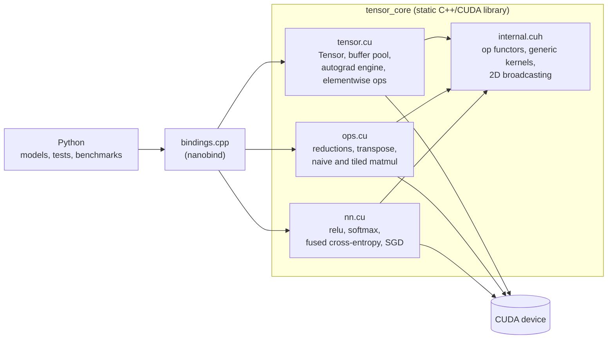

# minitensor

**A small tensor library with autograd, written from scratch in C++ and CUDA and used from Python.**


minitensor is a GPU tensor library built from the ground up: hand-written CUDA kernels, a reverse-mode autograd engine, a caching GPU memory allocator, and Python bindings that let you write ordinary NumPy-style code (`x @ W + b`) that runs entirely on the GPU.

It is small enough to read in an afternoon (about 1,100 lines of C++/CUDA in the core library) yet complete enough to train a neural network: a two-layer MLP on MNIST is under 100 lines of Python and reaches **~93% test accuracy in about a second**.

I built it for three reasons:

1. **To learn CUDA and ML-optimized processing.** This project served to teach me, from the hardware layer and machine code up, how to write and use CUDA and similar machine learning-optimized processing operations. I wanted a foundational understanding, not just the ability to use, CUDA and GPU processing.
2. **To understand what PyTorch actually does.** Every piece, from kernel launches and memory management to broadcasting and backprop, is implemented by hand and kept readable.
3. **To have a lightweight harness for writing and testing CUDA kernels.** Write a kernel in C++, expose it to Python in one line, then check it against NumPy or PyTorch and run a numeric gradient check with pytest.

```python
import minitensor as mt
import numpy as np

W1 = mt.Tensor.from_numpy(np.random.randn(784, 128).astype(np.float32) * 0.05)
W2 = mt.Tensor.from_numpy(np.random.randn(128, 10).astype(np.float32) * 0.1)
W1.requires_grad = W2.requires_grad = True

x = mt.Tensor.from_numpy(batch_images)            # float32 (64, 784), copied to the GPU
y = mt.Tensor.from_numpy(batch_labels)            # float32 (64,) class indices

loss = mt.softmax_cross_entropy(mt.relu(x @ W1) @ W2, y)
loss.backward()                                   # gradients computed on the GPU
for p in (W1, W2):
    mt.sgd_step(p, lr=0.075)                      # in-place update, no host round-trip
```

---

## Highlights

- **Hand-written CUDA kernels.** These cover elementwise ops, 2D broadcasting, tree reductions in shared memory (sum, mean, max, min, per-axis sums), transpose, naive and **tiled shared-memory matrix multiplication**, row-wise softmax, and a **fused softmax + cross-entropy** kernel with its own backward kernel.
- **Reverse-mode autograd.** A dynamic computation graph is recorded as ops run. `backward()` topologically sorts the graph and applies the chain rule, with gradient accumulation, broadcast-aware gradient reduction ("unbroadcasting"), and a `no_grad()` context.
- **Caching GPU allocator.** Freed buffers go into a size-bucketed pool and are reused without calling `cudaMalloc`/`cudaFree` again. If the GPU runs out of memory, the pool releases its cache and retries.
- **Pythonic API with nanobind.** It has operator overloading (`+ - * / @`, unary `-`, scalar ops on either side), `print()` support, `np.asarray(t)`, `.item()`, zero-copy `reshape`, and a generated `.pyi` stub so IDEs autocomplete with signatures and docstrings.
- **Tested against references.** About 35 pytest test functions (many of them parametrized) compare forward results with NumPy and gradients with hand-derived values and **finite-difference numeric gradients**, including every broadcasting case.

## Results

The MNIST benchmark (`tests/mlp_benchmark.py`) trains the same 784 → 128 → 10 ReLU MLP three times, with identical initialization, batch size 64, learning rate 0.075 and plain SGD:

| Implementation | Device | Time / epoch | Test accuracy (epoch 1) | Test accuracy (epoch 10) |
|---|---|---|---|---|
| **minitensor** | GPU | 0.2 s | 93.25 % | 97.35 % |
| PyTorch | GPU | 0.6–0.8 s | 93.25 % | 97.34 % |
| NumPy | CPU | 0.4 s | 93.25 % | 97.34 % |

<sub>Measured on: NVIDIA GeForce RTX 5060 Ti, Intel Core Ultra 7 265KF, Windows 11.</sub>

On this workload, minitensor runs an epoch about **2× faster than NumPy and 3–4× faster than PyTorch**. To be clear about why: at batch size 64 the matrices are tiny, so runtime is dominated by per-op overhead rather than arithmetic. minitensor's ops are thin calls straight into a CUDA kernel, using pooled memory. PyTorch carries general-purpose dispatch machinery that pays off at larger scales. This is a result about overhead on small models, not a claim that the kernels beat cuBLAS.

The matmul benchmark (`tests/speed_test.py`) compares the naive kernel, the tiled kernel and NumPy across shapes from 256³ up to 4096³ and reports ms and GFLOP/s for each.

## Getting started

### Requirements

- An NVIDIA GPU and the **CUDA Toolkit** (`nvcc`)
- **CMake ≥ 3.23** and a C++17 compiler (MSVC on Windows, GCC or Clang on Linux)
- **Python 3.12** (the version used in development), plus `numpy` and `nanobind`
- Optional: `pytest` for the tests, and `torch` for the comparison benchmark

### Build

```bash
git clone https://github.com/Jonathan-Lussier/minitensor.git
cd minitensor
pip install numpy nanobind pytest torch

# Set your GPU's compute capability first (see the note below)
cmake -S . -B build -DCMAKE_BUILD_TYPE=Release
cmake --build build --config Release
```

The build puts the compiled module (`minitensor.*.pyd` on Windows, `minitensor.*.so` on Linux) in the project root and regenerates `minitensor.pyi`, so `import minitensor` works from the repo directory.

> **GPU architecture:** `CMakeLists.txt` targets compute capability 8.9 (RTX 40-series) via `set(CMAKE_CUDA_ARCHITECTURES 89)`. Change `89` to match your card, for example `120` for RTX 50-series (needs CUDA 12.8 or newer), `86` for RTX 30-series, `75` for RTX 20-series or `80` for A100. Look up your card's compute capability on [NVIDIA's CUDA GPUs page](https://developer.nvidia.com/cuda-gpus).

### Run

Run everything from the repo root, so Python can find the compiled module and the `MNIST/` folder:

```bash
python -m tests.mlp_test         # train an MLP on MNIST (the dataset is included in MNIST/)
python -m tests.mlp_benchmark    # same model in minitensor vs NumPy vs PyTorch
python -m tests.speed_test       # matmul kernels vs NumPy, in ms and GFLOP/s
python -m pytest tests           # the full test suite
```

## Using minitensor

```python
import numpy as np
import minitensor as mt
from mt_utils import no_grad

# Creating tensors (float32, stored on the GPU)
a = mt.Tensor.from_list([2, 3], [1, 2, 3, 4, 5, 6])
b = mt.Tensor.from_numpy(np.ones((3, 2), dtype=np.float32))

# Math and broadcasting
c = a @ b                    # tiled matmul       -> (2, 2)
d = a * 2.0 + 1.0            # scalar ops
e = a + mt.Tensor.from_list([3], [10, 20, 30])   # broadcasting (2,3) + (3,)
print(mt.sum(a), a.mean(), a.max(), a.sum_axis(0), a.transpose())

# Autograd
x = mt.Tensor.from_numpy(np.random.randn(4, 3).astype(np.float32))
x.requires_grad = True
loss = mt.sum(mt.relu(x) * x)
loss.backward()
print(x.grad)                # dloss/dx, still on the GPU

# Inference without recording a graph
with no_grad():
    probs = mt.softmax(c)

# Interop
arr = x.to_numpy()           # or np.asarray(x)
import torch; t = torch.from_numpy(arr)
```

**Available ops:** `+ - * /` (2D broadcasting), unary `-`, `exp`, `log`, `relu`, `sum`, `sum_axis`, `mean`, `max`, `min`, `dot`, `matmul` / `@`, `naive_matMul`, `tiled_matMul`, `transpose`, `reshape`, `softmax`, `softmax_cross_entropy`, `sgd_step`, `synchronize`, `set_grad_enabled` / `is_grad_enabled`. See `minitensor.pyi` for signatures and docstrings.

## Using it as a CUDA kernel testbed

minitensor handles the parts of kernel work that aren't the kernel itself: GPU allocation, host↔device copies, Python bindings, autograd wiring and test scaffolding. Adding a new op takes four small steps. For example, a sigmoid:

**1. Write the device function** (`internal.cuh`). Elementwise ops are plain functors, which the generic `unaryOp` / `binaryOp` launchers turn into kernels:

```cpp
struct SigmoidOp { __device__ float operator()(float x) const { return 1.0f / (1.0f + expf(-x)); } };
```

**2. Write the op and its backward** (`nn.cu`, declared in `tensor.h`):

```cpp
Tensor sigmoid(const Tensor& a) {
    Tensor out = unaryOp(a, SigmoidOp{});
    if (needsGrad(a)) {
        // d/dx sigmoid(x) = y * (1 - y): reuse the output, detached to avoid a reference cycle
        recordNode(out, "sigmoid", {a}, [y = detach(out)](const Tensor& g) {
            return std::vector<Tensor>{ g * y * (Tensor::scalar(1.0f) - y) };
        });
    }
    return out;
}
```

For a kernel that isn't elementwise (a reduction, a custom matmul, a fused op), write a `__global__` function, allocate the output with `Tensor out(shape)` (the buffer comes from the pool), launch it, and check it with `cudaCheck(cudaGetLastError(), "...")`. `softmaxCrossEntropy` in `nn.cu` is a full example with separate forward and backward kernels.

**3. Expose it to Python** (`bindings.cpp`):

```cpp
m.def("sigmoid", &sigmoid, nb::arg("a"), "Elementwise logistic sigmoid.");
```

**4. Test it** (`tests/grad_test.py`, which already provides `numeric_grad` and `value_of`):

```python
def test_sigmoid_grad():
    x_np = rng.standard_normal((3, 4)).astype(np.float32)
    x = mt.Tensor.from_numpy(x_np); x.requires_grad = True
    mt.sum(mt.sigmoid(x)).backward()

    loss = lambda v: value_of(mt.sum(mt.sigmoid(mt.Tensor.from_numpy(v.astype(np.float32)))))
    np.testing.assert_allclose(x.grad.to_numpy(), numeric_grad(loss, x_np), rtol=1e-2, atol=1e-3)
```

Rebuild, and the new op is available in Python, autocompletes in your IDE and works inside any model. To time it, `time_it(fn, sync=mt.synchronize)` in `tests/speed_test.py` does warmup, GPU synchronization and median timing.

## How it works



- **Memory model.** A `Tensor` is a handle to a shared `TensorImpl`, which holds a `shared_ptr<float>` to device memory, the shape, and autograd state. Copying a tensor or calling `reshape` is free, and the buffer goes back to the pool when the last reference disappears.
- **Autograd.** Each differentiable op that sees an input with `requires_grad` records a `Node` holding its inputs and a backward closure. `backward()` builds a topological order with a depth-first search (in the same spirit as micrograd), seeds the output with `1`, and walks the graph in reverse. Backward runs under a `NoGradGuard`, so gradient computation doesn't build a new graph.
- **Broadcasting.** Binary ops on shapes up to 2D are broadcast with stride tricks in a single kernel. In backward, `unbroadcast` sums gradients back down to each input's original shape.
- **Matmul.** The default `matmul` is a tiled kernel in which each 16×16 thread block stages tiles of A and B in shared memory, so global memory reads are coalesced and reused. The naive one-thread-per-output kernel is kept for comparison.
- **Numerics.** Softmax and cross-entropy subtract the row max before exponentiating, and the fused cross-entropy kernel never materializes `log(softmax(x))`, so very large logits stay stable. Both cases are covered by tests.

## Project layout

| Path | What it is |
|---|---|
| `tensor.h` | Public C++ API: `Tensor`, `TensorImpl`, autograd `Node`, op declarations |
| `tensor.cu` | Tensor class, caching allocator, autograd engine, elementwise ops |
| `ops.cu` | Reductions, transpose, dot, naive and tiled matmul |
| `nn.cu` | ReLU, softmax, fused softmax-cross-entropy, SGD |
| `internal.cuh` | Shared kernels, op functors, broadcasting helpers |
| `bindings.cpp` | nanobind Python module |
| `minitensor.pyi` | Generated type stub for IDE autocomplete |
| `mt_utils.py` | Python helpers (`no_grad` context manager) |
| `tests/grad_test.py`, `tests/math_test.py`, `tests/training_test.py` | pytest suites: autograd, forward math, training (SGD, linear regression, XOR) |
| `tests/mlp_test.py`, `tests/mlp_benchmark.py`, `tests/speed_test.py` | MNIST training, framework comparison, matmul benchmark |
| `tests/tensor_test_main.cpp` | Small C++ program that uses the library directly, without Python |
| `MNIST/` | The MNIST dataset, used by the MLP scripts |
| `past_scripts/` | Earlier standalone CUDA experiments that the library grew out of |

## Limitations

minitensor is deliberately minimal. Know these before you build on it:

- **float32 only**, **GPU only**, and tensors are **at most 2D**.
- Ops run on the default CUDA stream, and there is no multi-GPU support.
- `backward()` must be called on a single-element tensor, such as a loss.
- The optimizer is plain SGD (`sgd_step`), and there is no module or layer abstraction yet.
- Matmul is hand-written, not cuBLAS. It is fast for a from-scratch kernel but won't match vendor libraries on large matrices.

## Roadmap

- [ ] Momentum and Adam optimizers
- [ ] Batched (3D) matmul and N-D broadcasting
- [ ] More activations and losses (sigmoid, tanh, GELU, MSE)
- [ ] Register-blocked matmul to push the tiled kernel further
- [ ] CUDA streams and asynchronous host↔device copies
- [ ] A pip-installable build (`scikit-build-core`)

## Acknowledgments

- The autograd design is inspired by Andrej Karpathy's [micrograd](https://github.com/karpathy/micrograd).
- The Python bindings use [nanobind](https://github.com/wjakob/nanobind).
- MNIST is from Yann LeCun, Corinna Cortes and Christopher Burges.

## License

Released under the [MIT License](LICENSE).